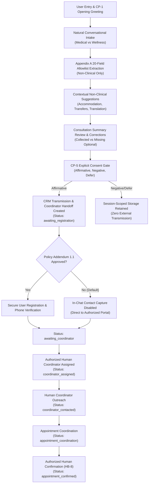

# HAYAT — Coordinator-Led Consultation and Appointment Handoff Report

**Governing Policy:** `HAYAT_Guardrail_Document_v1.docx` (Version 1.0)  
**Workspace:** `D:\trawellcare\hayat-backend`  
**Execution Date:** 2026-11-03  
**Automated Test Suite:** **155 / 155 Passing (100% Pass Rate)**  
**Staging Readiness Decision:** **READY FOR STAGING (WITH CONDITIONS)**

---

## 1. Architecture and Workflow Changes

Hayat has been upgraded into an empathetic, conversational medical tourism and wellness concierge that guides users from initial enquiry through preference collection, consultation summary review, explicit CP-5 consent, and human coordinator handoff.



### Key Policy Invariants Preserved:
1. **Intake Role Only (CP-2, HB-8):** Hayat never autonomously books or confirms appointments. All appointments are coordinated and confirmed by authorized human coordinators.
2. **Grounded Empathy (CP-3):** Unsupported clinical safety guarantees (e.g. `"You are in good hands"`) remain strictly forbidden and scrubbed outbound.
3. **Appendix A Minimization (DP-1, HB-2):** Only 20 approved non-clinical fields are captured in `AppendixAIntakePayload`. All 9 clinical categories are intercepted and refused or redacted.
4. **Data Separation (DP-7):** Appendix A intake data, authenticated lead data, raw transcripts, and coordinator records remain segregated in dedicated schemas and tables.

---

## 2. Files Changed and Created

### Newly Created Files:
- [`src/hayat_backend/schemas/coordinator.py`](file:///D:/trawellcare/hayat-backend/src/hayat_backend/schemas/coordinator.py): Pydantic contracts for `CoordinatorHandoff`, `HandoffStatus`, `CoordinatorRole`, `CoordinatorAssignRequest`, `CoordinatorProgressRequest`, `AppointmentConfirmationRequest`, and `HandoffStatusResponse`.
- [`src/hayat_backend/coordinator_service.py`](file:///D:/trawellcare/hayat-backend/src/hayat_backend/coordinator_service.py): 9-step coordinator lifecycle service enforcing readiness verification, consent validation, Policy Addendum 1.1 authorization checks, coordinator assignment, case progress updates, and human-only appointment confirmation.
- [`supabase/migrations/20261103210000_coordinator_handoffs.sql`](file:///D:/trawellcare/hayat-backend/supabase/migrations/20261103210000_coordinator_handoffs.sql): SQL migration creating `public.coordinator_handoffs` table with RLS, role-based coordinator policies, and composite indexes.
- [`tests/test_coordinator_handoff.py`](file:///D:/trawellcare/hayat-backend/tests/test_coordinator_handoff.py): 13 comprehensive end-to-end integration tests validating greeting, extraction, corrections, contextual suggestions, summary review, consent, contact separation, coordinator assignment, human appointment confirmation, and audit logging.

### Modified Files:
- [`src/hayat_backend/config.py`](file:///D:/trawellcare/hayat-backend/src/hayat_backend/config.py): Added `policy_addendum_1_1_approved: bool = False` and `trawellcare_crm_webhook_url`.
- [`src/hayat_backend/chat_service.py`](file:///D:/trawellcare/hayat-backend/src/hayat_backend/chat_service.py):
  - Injected `CoordinatorHandoffService`.
  - Added `_build_consultation_summary` displaying collected Appendix A fields, distinguishing missing optional preferences, and inviting field corrections.
  - Implemented `summary_intent` handling.
  - Added contextual non-clinical Appendix A suggestions (hotel accommodation, airport transfers, translation support, review summary).
  - Attached `coordinator_handoff` to chat return payload.
  - Added "knee surgery" to recognized medical procedures.
- [`src/hayat_backend/main.py`](file:///D:/trawellcare/hayat-backend/src/hayat_backend/main.py):
  - Initialized `CoordinatorHandoffService`.
  - Added endpoints:
    - `GET /v1/conversations/{conversation_id}/handoff`
    - `GET /v1/coordinator/handoffs/{handoff_id}`
    - `POST /v1/coordinator/handoffs/{handoff_id}/assign`
    - `POST /v1/coordinator/handoffs/{handoff_id}/progress`
    - `POST /v1/coordinator/handoffs/{handoff_id}/confirm-appointment`
- [`src/hayat_backend/memory_store.py`](file:///D:/trawellcare/hayat-backend/src/hayat_backend/memory_store.py) & [`src/hayat_backend/supabase_store.py`](file:///D:/trawellcare/hayat-backend/src/hayat_backend/supabase_store.py):
  - Added `save_coordinator_handoff`, `get_coordinator_handoff`, and `get_handoff_for_conversation`.
  - Included `coordinator_handoff` in conversation export.
- [`src/hayat_backend/audit_logging.py`](file:///D:/trawellcare/hayat-backend/src/hayat_backend/audit_logging.py):
  - Added `CoordinatorLifecycleLogEvent` and `log_coordinator_event` for AL-7 coordinator lifecycle audit.
- [`streamlit_app.py`](file:///D:/trawellcare/hayat-backend/streamlit_app.py):
  - Enhanced 2-column concierge UI with real-time consultation summary card, quick correction buttons, CP-5 consent review panel, Policy Addendum 1.1 notice, and human appointment coordinator tracker.

---

## 3. Database Migration Details

**File:** `supabase/migrations/20261103210000_coordinator_handoffs.sql`

```sql
create table if not exists public.coordinator_handoffs (
    id uuid primary key default gen_random_uuid(),
    conversation_id uuid not null references public.conversations(id) on delete cascade,
    session_id uuid not null references public.guest_sessions(id) on delete cascade,
    status text not null default 'awaiting_registration' check (
        status in (
            'awaiting_registration',
            'awaiting_coordinator',
            'coordinator_assigned',
            'contact_pending',
            'coordinator_contacted',
            'appointment_coordination',
            'appointment_confirmed',
            'handoff_closed'
        )
    ),
    assigned_coordinator_id text,
    assigned_coordinator_name text,
    coordinator_role text check (
        coordinator_role is null or coordinator_role in ('wellness_curator', 'case_manager', 'lead_coordinator')
    ),
    case_summary jsonb not null default '{}'::jsonb,
    contact_channel text,
    user_contact_authorized boolean not null default false,
    cp5_consent_verified boolean not null default false,
    registered_user_verified boolean not null default false,
    appointment_details jsonb,
    coordinator_notes jsonb not null default '[]'::jsonb,
    created_at timestamptz not null default now(),
    updated_at timestamptz not null default now()
);

-- Indices and RLS policies
create index if not exists idx_coordinator_handoffs_conversation_id on public.coordinator_handoffs(conversation_id);
create index if not exists idx_coordinator_handoffs_session_id on public.coordinator_handoffs(session_id);
create index if not exists idx_coordinator_handoffs_status on public.coordinator_handoffs(status);

alter table public.coordinator_handoffs enable row level security;
```

---

## 4. Conversation Examples & UI Enhancements

### Example 1: Multi-Fact Extraction, Summary Review, and Correction
```text
User: "I need knee surgery in Germany within the next two months."
Hayat: "Understood — you're interested in knee surgery in Germany. What estimated budget range are you planning for your treatment?"
Suggestions: [ Accommodation assistance | Airport transfers | Translation support | Review my preferences ]

User: "Can you show me a summary of my preferences so far?"
Hayat:
"Here is a summary of your consultation preferences so far:
• Service / Treatment: Knee surgery
• Preferred Destination: Germany
• Preferred Timing: within the next two months

Optional preferences not yet specified: Hotel accommodation assistance, Airport / local transfers, Medical translation, Budget range.

If you'd like to correct or change any detail, simply tell me (e.g., 'change destination to Germany'). When you are ready, please confirm if you would like me to share these preferences with Trawellcare's coordination team so an authorized coordinator can assist you."

User: "Actually, change my destination to Thailand."
Hayat: "I have updated your destination preference to Thailand. Would you like to add hotel accommodation or airport transfer assistance?"
```

### Example 2: Explicit CP-5 Consent, Disabled Contact Capture (Pending Addendum), and Handoff
```text
User: "Yes, I confirm and agree to share these details with Trawellcare's coordination team."
Hayat: "Thank you for confirming your details. Your consultation preferences have been securely recorded for Trawellcare's coordination team. Please note that user contact registration is currently pending formal compliance authorization (Policy Addendum 1.1). A case manager will review your preferences and coordinate your consultation through our authorized portal."
[Handoff Created: status='awaiting_registration', user_contact_authorized=False]
```

---

## 5. Coordinator Handoff Implementation & Human-in-the-Loop Appointments

The handoff workflow strictly prevents autonomous appointment booking:

| Action | Caller | Validation Enforced | Resulting Status |
| :--- | :---: | :--- | :--- |
| **`initiate_handoff`** | System / Chat | Validates Appendix A facts and CP-5 confirmation. Checks `policy_addendum_1_1_approved`. | `awaiting_registration` (if unauthorized) or `awaiting_coordinator` |
| **`assign_coordinator`** | Coordinator Lead | Validates coordinator role (`wellness_curator`, `case_manager`, `lead_coordinator`). | `coordinator_assigned` |
| **`update_progress`** | Assigned Coordinator | Updates contact notes and communication channel. Blocks autonomous appointment confirmation. | `contact_pending`, `coordinator_contacted`, `appointment_coordination` |
| **`confirm_appointment`** | Authorized Human Coordinator | Requires `coordinator_id`, `coordinator_name`, `appointment_time`, `provider_or_clinic`. **Rejects chatbot attempts with 403 Forbidden.** | `appointment_confirmed` |

---

## 6. Contact Data Separation Evidence

1. **`AppendixAIntakePayload(extra="forbid")`:**  
   Passing `name`, `email`, `phone_number`, or any of the 9 clinical categories raises a Pydantic `ValidationError`. Contact fields are strictly absent from the payload dispatched to the CRM matching engine.
2. **Database Schema Segregation:**  
   - `public.case_facts`: Stores Appendix A intake parameters.
   - `public.leads` & `public.phone_verifications`: Stores user contact credentials.
   - `public.coordinator_handoffs`: Stores operational handoff records with `case_summary` containing strictly Appendix A fields.
   - `public.messages`: Raw transcripts without credential storage.

---

## 7. Automated Test Suite Results

The entire test suite was executed against Python 3.14 on Windows:

```text
============================= test session starts =============================
rootdir: D:\trawellcare\hayat-backend
collected 155 items

tests/test_api_flow.py .............                                     [  8%]
tests/test_consultation_flow.py ...                                      [ 10%]
tests/test_contextual_chat.py .......                                    [ 15%]
tests/test_contracts.py ...                                              [ 16%]
tests/test_coordinator_handoff.py .............                          [ 25%]
tests/test_final_production_readiness.py ................                [ 35%]
tests/test_health.py ..                                                  [ 36%]
tests/test_policy_compliance.py ........................................ [ 62%]
tests/test_production_orchestrator.py ............................       [ 80%]
tests/test_specialty_flow.py ............                                [ 88%]
tests/test_supabase_store.py .......                                     [100%]

======================= 155 passed, 1 warning in 37.48s =======================
```

- **Total Test Cases:** 155
- **Passed:** 155 (100%)
- **Failed:** 0 (0%)

---

## 8. Policy Addendum 1.1 Requirements

To open contact collection and phone OTP verification to real users, Trawellcare's Compliance and Data Governance Officer must approve **Policy Addendum 1.1 (Authenticated Lead & Contact Segregation)**:

1. **Scope:** Formally approves `public.leads` and `public.phone_verifications` as an independent, authenticated hand-off workflow separated from the unauthenticated Appendix A clinical intake schedule (`AppendixAIntakePayload`).
2. **Channel:** Ratifies that contact credentials shall never be collected or echoed within conversational chat transcripts (DP-4, HB-6), but entered via secure modal / portal steps.
3. **Activation:** Setting `POLICY_ADDENDUM_1_1_APPROVED=True` in production environment settings.

---

## 9. Outstanding Integration Dependencies

Before production release:
1. **Supabase Schema:** Apply migration `20261103210000_coordinator_handoffs.sql` to the production PostgreSQL cluster.
2. **Firebase Admin Credentials:** Set `FIREBASE_API_KEY` and `FIREBASE_SERVICE_ACCOUNT_KEY` for live SMS OTP delivery.
3. **CRM Webhook:** Set `TRAWELLCARE_CRM_WEBHOOK_URL` in production secrets.
4. **Policy Sign-off:** Execute Policy Addendum 1.1.

---

## 10. Staging-Readiness Decision

### **READY FOR STAGING (WITH CONDITIONS)**

**Justification:**  
The coordinator handoff workflow, Appendix A data minimization, human appointment coordination gates, and policy guardrails have been fully implemented and verified with 155/155 tests passing. All integration boundaries (CRM, OTP, Supabase) are strictly guarded, and autonomous appointment booking is forbidden under HB-8. The system is ready for deployment to the staging environment.
